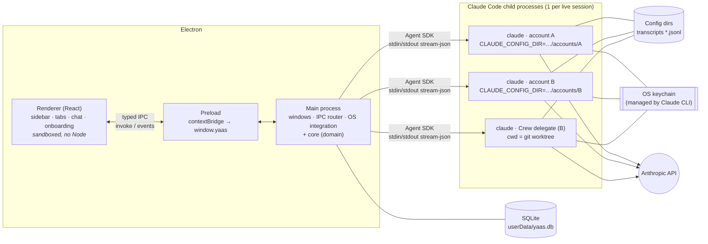
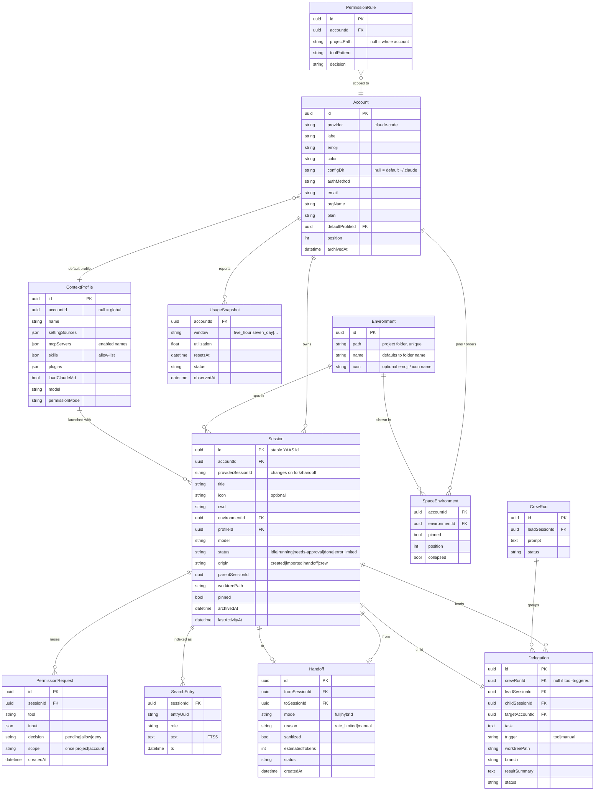
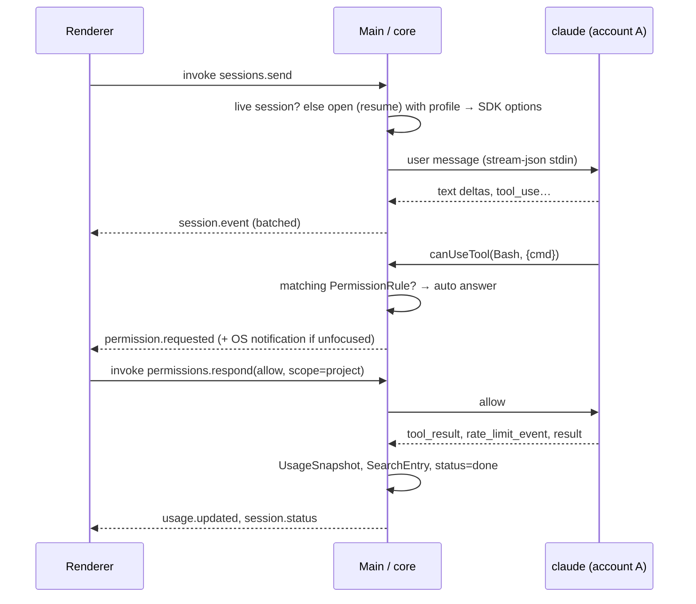

# YAAS — architecture

> Status: **accepted** (2026-11-19). Decisions marked *(ADR)* have their own record in [`adr/`](adr/).
> UI details: [`DESIGN.md`](DESIGN.md).
> Feature scope: [`FEATURES.md`](FEATURES.md). Spike evidence: [`spikes/2026-11-19-risk-validation.md`](spikes/2026-11-19-risk-validation.md) (S#n).

## 1. Stack *(ADR-0001)*

| Concern | Choice | Why |
|---|---|---|
| Shell | **Electron** | The Agent SDK is Node; native vibrancy (macOS) and Mica/Acrylic (Win 11); one codebase. Tauri was rejected: Rust shell + Node sidecar for the SDK = two runtimes for no gain |
| Build | **electron-vite** (Vite for main, preload and renderer) | One config, HMR in the renderer, fast main rebuilds |
| Language | TypeScript `strict` everywhere | — |
| UI | React 19 + **Zustand** (state) + CSS Modules + CSS variables (design tokens) | Small, fast; tokens map 1:1 to the theme settings. No Tailwind: the look relies on tokens, glass and grain, not utility classes |
| Lists | `@tanstack/react-virtual` | Long transcripts and session lists |
| Claude | `@anthropic-ai/claude-agent-sdk` (spawns the Claude Code CLI) | Streaming, `canUseTool`, `resume`/`forkSession`, in-process MCP (S#7) |
| Storage | **SQLite** via built-in `node:sqlite` + FTS5, migrations on `user_version` *(ADR-0005)* | No native module; same engine in Electron and in tests |
| Validation | `zod` on every IPC payload entering main | The renderer is untrusted |
| Terminal (v1) | `node-pty` + `xterm.js` | Escape hatch only |
| Packaging | electron-builder → `dmg` (mac), `nsis` (win) | As required; SDK native binary `asarUnpack`ed (S#7) |
| Tests | Vitest (unit/contract), Playwright `_electron` (e2e) | — |

## 2. Processes



- **Renderer**: `contextIsolation: true`, `nodeIntegration: false`, `sandbox: true`. Talks only to `window.yaas`.
- **Main**: hosts the Electron shell *and* the domain core. The core never imports `electron`
  (rule enforced by ESLint), so it can move to a `utilityProcess` later if streaming ever makes the
  main process janky — without touching domain code.
- **Children**: one Claude Code process per *live* session, started by the Agent SDK in streaming-input
  mode (the process survives across turns). Idle sessions are closed after 10 min and transparently
  resumed (`resume`) on the next message. Credentials never pass through YAAS: each child reads its
  own keychain entry, keyed by its config dir (S#1).

## 3. Source layout

Adapted from the indicative tree: the domain moves out of `main/` into `core/` so it stays
Electron-free and testable with a fake provider.

```
src/
  main/                    # Electron shell only
    index.ts               # app lifecycle, single-instance lock
    windows/               # BrowserWindow creation, vibrancy/mica, traffic lights
    browser/               # TabViews: one WebContentsView per tab; OverlayView (§11)
    ipc/                   # handlers: zod-validate → call core → return; event fan-out
    os/                    # notifications, dock/taskbar badge, menus, shortcuts
    secrets.ts             # safeStorage wrapper (Windows token fallback, S#8)
  core/                    # domain — NO electron imports
    accounts/              # Account CRUD, config dir creation, auth login/status
    profiles/              # Context profiles → provider launch options, context-size estimate
    sessions/              # lifecycle, live-session registry, idle reaper, import
    permissions/           # pending requests, rules (once / always-for-project / deny)
    usage/                 # UsageSnapshot from rate-limit events
    handoff/               # full + hybrid handoff, transcript sanitizer
    crew/                  # delegate tool (in-process MCP), manual runs, worktrees
    providers/
      provider.ts          # Provider interface + normalized events
      claude-code/         # Agent SDK adapter, transcript reader, path encoding
      fake/                # deterministic provider for tests & e2e (0 tokens)
    store/                 # SQLite (node:sqlite), migrations, FTS index
    events.ts              # typed in-process event bus (core → ipc)
  preload/
    index.ts               # exposes window.yaas (invoke/on), nothing else
    browserMirror.ts       # space sessions only: mirrors chrome.* onto browser.* (extensions)
  renderer/
    app/                   # routes: onboarding, main layout
    features/              # sidebar, tabs, chat, approvals, palette, settings, crew
    theme/                 # tokens.css, grain overlay, glass, ThemeProvider
    stores/                # Zustand slices fed by IPC events
  shared/
    ipc.ts                 # THE contract: channels, payload & result types, zod schemas
    model.ts               # domain types shared with the renderer
docs/  scripts/  tests/e2e/
```

## 4. Provider abstraction

Everything provider-specific sits behind one interface; only `ClaudeCodeProvider` exists for now.

```ts
interface Provider {
  readonly id: 'claude-code' // | 'codex' later
  auth: {
    login(account: Account): Promise<void>          // opens the browser flow
    status(account: Account): Promise<AuthStatus>   // email, org, plan
  }
  discoverSessions(account: Account): AsyncIterable<DiscoveredSession> // import
  readTranscript(account: Account, ref: ProviderSessionRef): AsyncIterable<TranscriptEntry>
  open(opts: OpenSessionOptions): LiveSession       // new or resume (+ fork)
  copyTranscript(from: Account, to: Account, ref: ProviderSessionRef,
                 opts: { sanitize: boolean }): Promise<ProviderSessionRef> // handoff
}

interface LiveSession {
  send(input: UserInput): void
  interrupt(): Promise<void>
  close(): Promise<void>
  events: AsyncIterable<ProviderEvent>
}

type ProviderEvent =
  | { kind: 'init'; providerSessionId: string; model: string; tools: string[] }
  | { kind: 'text-delta' | 'thinking-delta'; messageId: string; text: string }
  | { kind: 'message'; entry: TranscriptEntry }            // complete assistant/user message
  | { kind: 'tool-use'; id: string; name: string; input: unknown }
  | { kind: 'tool-result'; toolUseId: string; output: unknown; isError: boolean }
  | { kind: 'permission-request'; requestId: string; tool: string; input: unknown }
  | { kind: 'rate-limit'; status: 'allowed' | 'warning' | 'rejected'; windows: UsageWindow[]; resetsAt?: number }
  | { kind: 'turn-end'; usage: TokenUsage; costUsd: number; stopReason: string }
  | { kind: 'error'; code: 'rate_limited' | 'auth' | 'prompt_too_long' | 'invalid_thinking_signature' | 'other'; message: string }
```

`ClaudeCodeProvider` maps profiles to SDK options: `env.CLAUDE_CONFIG_DIR` (omitted for the
imported default account, so the CLI keeps using its original keychain entry), `settingSources`,
`mcpServers` + `strictMcpConfig`, allowed skills/plugins, `model`, `canUseTool`, `resume`, `forkSession`.

## 5. Data model

**Source of truth for conversations = the provider's transcript files.** SQLite holds metadata,
links between sessions, usage, permissions and a search index — never a second copy of the
conversation. This avoids drift with the CLI and keeps imports free.



An **environment** is a project folder. It is global (the same folder can host sessions of
several accounts, e.g. after a handoff); pinning, order and collapsed state are per space
(`SpaceEnvironment`).

App settings (theme tokens, layout options, auto-archive, onboarding done, shortcuts) live in a small
`settings` key/value table.

**On disk**

```
<userData>/
  yaas.db
  accounts/<accountId>/        # CLAUDE_CONFIG_DIR of each YAAS-created account — never moved (S#1)
~/.claude/                     # imported "Default" account, read in place, never moved
<repo>/.yaas-worktrees/<id>/   # Crew worktrees (git-ignored)
```

## 6. IPC contract

One file, `src/shared/ipc.ts`, defines every channel. Two kinds:

- **Commands** (renderer → main, request/response): `accounts.list`, `accounts.add`, `sessions.create`,
  `sessions.send`, `sessions.interrupt`, `permissions.respond`, `handoff.propose`, `handoff.run`,
  `crew.start`, `settings.update`, …
- **Events** (main → renderer, push): `session.event`, `session.status`, `permission.requested`,
  `usage.updated`, `handoff.suggested`, …

```ts
// shared/ipc.ts (shape)
export const commands = {
  'sessions.send': { input: z.object({ sessionId: z.string().uuid(), text: z.string().min(1) }), output: z.void() },
  // …
} satisfies Record<string, { input: ZodType; output: ZodType }>

// renderer
await window.yaas.invoke('sessions.send', { sessionId, text })
const off = window.yaas.on('session.event', (e) => …)
```

The preload exposes only `invoke(channel, payload)` and `on(event, cb)`, with the channel name typed
as `keyof typeof commands`; main rejects unknown channels and invalid payloads. Streaming deltas are
**batched per ~16 ms** before crossing IPC to avoid flooding the renderer.

**The one exception: `window.browserAction` in the overlay.** The site menu lists the tab's
extension actions with `<browser-action-list>` from `electron-chrome-extensions`, which only works
with the library's own bridge. So the preload calls `injectBrowserAction()` (bundled into the
preload) **only when the page is the overlay** (`location.hash === '#overlay'`); the UI window
never gets it. It defines the `<browser-action-list>` / `<browser-action>` elements and exposes
`window.browserAction`: `getState(partition)`, `activate(partition, details)` (click: run the
action or open its popup; right-click: its context menu), `addObserver` / `removeObserver` and
update listeners. It goes through the library's `crx-msg-remote` channel, not through
`window.bigBrowser`, and gives no raw `ipcRenderer`. Note the library's `browserAction.getState` /
`activate` handlers accept **any sender** (`allowRemote: true`) for any partition: the exposure is
the library's, registered on `ipcMain` as soon as a space session exists, and the overlay only
uses it to read and activate actions.

## 7. Key flows

### 7.1 Send a message (with a permission request)



### 7.2 Handoff *(ADR-0003)*

| Option | + | − |
|---|---|---|
| **Full transcript** (copy JSONL → target, `resume` + `forkSession`) | Zero context loss; no extra model call; source untouched | First turn re-reads everything without cache (cost spike); may hit `invalid_thinking_signature` |
| **Compact summary** (new session seeded with a summary) | Cheap ongoing turns | Loses detail; the summary must be produced by the *target* (source is exhausted) |
| **Hybrid** (summary + last N turns + todo + `git status`) | Good balance for long sessions | Most complex; one summarisation call |

Decision: **full transcript in MVP**, hybrid in v1. Flow:
`rate-limit warning|rejected` → `handoff.suggested` banner (target suggested by lowest utilization)
→ user confirms, sees estimated tokens → `copyTranscript` (sanitize on retry) → new Session
(`origin=handoff`, `parentSessionId`) on target → tab replaces the old one, chain visible in UI.

### 7.3 Crew *(ADR-0004)*

| Mechanism | + | − / limits |
|---|---|---|
| **A. In-process MCP tool** `delegate_to_account` (`createSdkMcpServer`) injected into the lead | Lead can propose delegation itself; approval comes for free through `canUseTool`; no port, no auth | Only for sessions launched by YAAS; a long child run blocks the lead's tool call → use `delegate` (returns a ticket) + `await_delegations` |
| **B. Local MCP server over HTTP** (localhost + token) | Usable from any Claude Code (terminal, Desktop) | Port/auth/security handling; only useful if YAAS becomes a companion |
| **C. Manual Crew** (YAAS spawns children directly) | Deterministic, user in control, no extra tool tokens in the lead | Lead doesn't drive; a final aggregation turn is needed |
| **D. Native subagents (Task tool)** | Built-in | ❌ Always the parent's account — not viable |

Decision: **A + C in v1**, B later if ever. The tool is registered only while Crew is enabled on the
session (token principle). Each child runs in its own git worktree/branch, with its own profile;
results come back to the lead as a short summary + branch name, never the full child transcript.

## 8. Token overhead guardrails

- The core has **no code path that calls a model** except: user messages, user-confirmed handoff
  summary (hybrid), user-confirmed Crew split. Enforced by review + a test that runs the full app
  flow on the fake provider and asserts zero unexpected `open/send` calls.
- `scripts/token-overhead.ts` (opt-in, real account): same prompt via YAAS core vs plain `claude -p`,
  compares `turn-end.usage`; must stay within a small tolerance.

## 9. Security

- Renderer sandboxed; strict CSP; no remote content; `will-navigate`/`window.open` blocked;
  links open in the default browser.
- No YAAS-held secrets on macOS (the CLI owns its keychain entries). On Windows, if S#8 confirms a
  plaintext file, use `setup-token` and keep the token in `safeStorage`, injected as
  `CLAUDE_CODE_OAUTH_TOKEN`.
- Permission rules are explicit and visible; "allow for account" requires a second confirmation.

## 10. Testing

| Level | Tool | Notes |
|---|---|---|
| Core unit | Vitest | Against `FakeProvider` — 0 tokens |
| Contract | Vitest | Real transcript fixtures (anonymised) → reader/sanitizer; CLI event fixtures → normalizer |
| IPC | Vitest | Every command schema rejects bad payloads |
| E2E | Playwright `_electron` | App launched with a temp userData (`BIG_BROWSER_USER_DATA`), no real account |
| Real-account spikes | scripts | Opt-in, never in CI |

## 11. Browser

- **Model in core.** `core/browser/browserStore.ts` owns spaces, tabs and folders (SQLite,
  `spaces` / `tabs` / `folders` tables) and knows nothing of Electron. Main mirrors it; the
  renderer only sees it through `browser.state` and the `browser.changed` event (`BrowserState` =
  the snapshot plus every tab's `runtime`: loading, back/forward, `theme-color`, the view's
  `webContentsId`, `loaded` — live data, never persisted; a tab without a view gets an idle entry
  with `loaded: false`, which the sidebar dims). Besides order and nesting, a folder has an
  `icon` (`hue:<deg>` or an emoji; null = a hue from its name), a space an `icon` (an emoji;
  null = its colour dot) and `sectionCollapsed`, and a tab `lastActiveAt` (set by `activateTab`
  and by `openTab` when it activates; Recent Tabs sorts by it) — migration 5.
- **Splits.** Two tabs of one space can be paired side by side (migration 8): the second tab's
  `split_of` points at the first, which keeps `split_ratio` (the first page's share, 0.25–0.75;
  null = 0.5). The second mirrors the first's section, folder and parent and is out of every list
  (`visibleOrder`, list lengths and positions, sidebar rows); the sidebar draws the pair as one
  `split` node and `BrowserView.activeSplit` says which half is active. Commands
  `browser.splitTabs` (same space, neither already split, else `invalid_move`), `browser.separate`
  (the second goes right after the first), `browser.setSplitRatio` (clamped) and
  `browser.splitActive` (`⌃⌘\` and the + menu: the active tab with the next row of its list, else
  the previous — `core/browser/splitPartner.ts`; nothing when there is none). `moveTab` of
  either half moves the pair; removing one half (or closing a today half) first ends the split,
  the other half taking the row's place (and the focus, when the closed one had it). Closing a
  half of a pinned or favourite split only unloads it and keeps the pair; `browser.closeSplit`
  (a split row's ×) unloads both halves of such a split, or deletes both of a today split, and
  moves the focus off the pair. Undo brings a closed half
  back as a normal tab; a deleted folder's splits are separated first, so they come back as two
  normal tabs. A broken pair (first gone, in another space, itself a second) is repaired at
  startup into a normal tab at the end of its list.
- **History.** `core/browser/historyStore.ts` keeps one `history` row per page (URL) per space
  with a visit count and last visit (migration 6; rows go with their space). `TabViews` records
  on a tab's top-level `did-navigate` (http(s) only, not in-page or frames) and updates the title
  on `page-title-updated`. Commands `history.frequent` (a space's most visited, for the new-tab
  dock), `history.search` (all spaces) and `history.forget`; deleting a space wipes its rows.
  History is personal data: it stays in this SQLite file and is never sent anywhere.
- **Downloads.** `main/browser/downloads.ts` hooks `will-download` once on every space session
  (`SpaceSessions` `onSession`) and saves straight to `app.getPath('downloads')`, no dialog, under
  `uniqueDownloadPath` (`a (1).pdf` when `a.pdf` is taken). `core/browser/downloadsStore.ts` keeps
  one `downloads` list for all spaces (migration 7, no space id); a row still `progressing` at
  startup becomes `interrupted`. Progress events are throttled to one per 250 ms per download.
  Commands `downloads.list`, `downloads.clear` (finished rows only, never the files) and
  `downloads.show` (`shell.showItemInFolder`); event `downloads.changed` (the whole list) goes to
  the UI and the overlay. Deleting a space wipes its session but not its downloads: the
  `DownloadItem` outlives the session's storage, so a running download finishes and is recorded.
  Downloads are personal data: local SQLite only.
- **Sections.** A space's tabs sit in `favorites` (tiles), `pinned` (a tree of folders: a folder
  is at the top level or in another folder, `parentId`; the tabs and child folders of one parent
  share one ordering; `moveFolder` moves a folder with its subtree, never into itself or a
  descendant — `invalid_move`; the sidebar indents a level per step up to `MAX_FOLDER_INDENT` = 4,
  the model has no limit) and `today` (a tree: a tab
  opened from another is its child, `parentId`, drawn under it; closing a parent hands its
  children to its own parent). `visibleOrder` is the drawn order: the next active tab after a
  close and `Ctrl+Tab` follow it. Moving into today takes an index in drawn order; leaving today
  drops the parent.
- **Close, unload, remove.** The user's close (`browser.closeTab`, `Mod+W`, an extension's
  `chrome.tabs.remove`, the tab menu) deletes a today tab but only **unloads** a favourite or
  pinned tab: the entry stays and its view is destroyed. The model often doesn't change then (a
  non-active tab), so `TabViews.sync` can't see it: `BrowserStore.closeTab` returns `'unloaded'`
  and main calls `TabViews.unload` at every call site (`closeTab` in `main/index.ts`).
  `browser.removeTab` deletes a tab whatever its section; deleting a folder deletes its child
  folders and all their tabs.
- **Undo.** Deleted tabs go on an in-memory stack of 20 (`core/browser/undoStack.ts`); an entry
  is `{ folders, tabs }`: one tab, or a deleted folder's whole subtree (when it held tabs).
  `browser.reopenClosed` / `Mod+Shift+T` (menu accelerator, works over pages) puts the last one
  back where it was — folders first, with their ids, parents and positions, then their tabs — or
  a tab at the end of the active space's today when its space or folder is gone, and activates
  the first tab. `Mod+Z` does the same from a keydown handler of
  the UI (`app/Shell.tsx`), only when no input, text area or editable element has focus; in a page
  or a field it stays the text undo.
- **Sidebar menus.** `browser.showTabMenu { tabId, at }` / `browser.showFolderMenu { folderId,
  at }` (`at` = the right-click's `clientX/clientY`, window coordinates) build the row's items in
  `main/browser/sidebarMenus.ts` (`tabMenu` / `folderMenu`) and draw them in the overlay at the
  pointer (`showMenu`, see **Drawn menus**). Tab: Pin / Unpin
  (pinned end / today top), Add to / Remove from Favourites (favourites end / today top), Move to
  Folder ▸ (the space's folders, the current one checked, New Folder…), Copy Link, Duplicate, then
  Remove (favourite, pinned) or Close (today). Folder: Rename, Move to Folder ▸ (Top level, then
  every folder of the space outside its own subtree; where it is now is checked and disabled),
  Delete Folder. Rename (and New Folder…) emit
  `browser.shortcut` `{ kind: 'rename-folder', folderId }`: the sidebar edits the name in place.
- **Space menu.** `browser.showSpaceMenu { spaceId, anchor }` (anchor = the space header's "…"
  button) builds `spaceMenu` (`sidebarMenus.ts`) and draws it below the button (`anchored-menu`):
  filter, Rename Space… (`browser.shortcut` `{ kind: 'rename-space', spaceId }`: the header edits
  the name in place), Change Space Icon… / Edit Look… (overlay kinds `space-icon` / `space-color`
  `{ anchor, spaceId }`, opened from the same button; the overlay calls `setSpaceIcon` /
  `setSpaceColor`), New Folder (created in that space, then `rename-folder`), Space Settings…
  (`settings`), Delete Space… (disabled for the last space) → overlay kind `confirm`
  `{ anchor, message, confirmLabel, action: { kind: 'delete-space', spaceId } }`, whose confirm
  button calls `browser.deleteSpace` from the overlay.
- **Page menu.** A page's `context-menu` event (`TabViews.showPageMenu`) builds the entries of
  `core/browser/pageMenu.ts` (spelling suggestions first — at most 5, each running
  `replaceMisspelling`, or a disabled "No Suggestions" —, then link, image, edit or selection
  entries, Back / Forward / Reload on a blank spot, then Inspect), splices the space's
  `chrome.contextMenus` items before Inspect (converted by `main/menus/fromElectron.ts`
  `toMenuItemDefs`: submenus, separators, checks, icons as 16 px PNG data URLs; choosing one calls
  the item's own `click` like Electron would, so the extension's `onClicked` gets the tab), and
  draws them with `showMenu` at `params.x/y` plus the page view's origin. No macOS Look Up /
  Services.
- **Drawn menus.** Every menu is drawn by the overlay; no `Menu.popup` is left in `src/main`
  except the macOS share menu and the app menu bar (an extension action's own right-click menu,
  opened by electron-chrome-extensions, is the library's). A choice whose target changed meanwhile
  (`BrowserError` `not_found` or `invalid_move`) does nothing, and the overlay catches a failed
  `overlay.choose`. Wire format (`shared/menuSpec.ts`):
  `MenuSpec = { id, items: MenuSpecItem[] }`, an item `{ kind: 'item', id, label, enabled, icon?
  (a Phosphor name or a `data:image/` URL), shortcut?, checked?, submenu? }`, `{ kind:
  'separator' }`, or a leading `{ kind: 'filter' }` (a field narrowing the rows). Main builds
  `MenuItemDef`s (the same, plus `run()`), and `showMenu(where, items)` hands them to the
  `MenuRegistry` (`main/menus/menuRegistry.ts`), which keeps the actions, strips them and gives the
  menu a fresh id, then opens the overlay with `{ kind: 'context-menu', at, menu }` (at a point)
  or `{ kind: 'anchored-menu', anchor, placement, menu }` (from a button). The overlay answers
  `overlay.choose { menuId, itemId }`: the registry runs that item once, only for the current menu
  (a stale id, a disabled or unknown item does nothing), and ignores a `BrowserError('not_found')`
  — the tab, folder or space vanished while the menu was open. Closing the overlay, or any
  `overlay.open` from a renderer, clears the registry.
- **Favicons.** On `page-favicon-updated` main fetches the first candidate through the tab's
  session (`session.fetch`, its cookies, 10 s timeout) and stores it as a `data:` URL
  (`core/browser/favicon.ts` `faviconDataUrl`: `image/*` only, at most 64 KB — reading stops past
  the cap — else no icon). The UI's CSP (`img-src 'self' data: crx:`) stays closed to the web. A
  newer page's icon wins over an older, slower request.
- **One view per tab.** `main/browser/tabViews.ts` gives every tab its own `WebContentsView`,
  added to the window's `contentView` above the UI. Only the active tab of the active space is
  visible. Views are `sandbox` + `contextIsolation`, no `nodeIntegration`, **no app preload; the
  session's `browser.*` mirror only**; the
  user agent is plain Chrome (`core/browser/userAgent.ts` drops the `Electron/` and `Big Browser/`
  tokens). Popups, `target=_blank` and "Open Link in New Tab" become tabs in the same space
  (`deny` + `openTab` with `parentId` = the opener), never windows; `will-navigate` to a
  non-http(s) scheme is blocked.
- **Partitions.** Each space browses in its own persistent session,
  `persist:space-<spaceId>`: cookies and storage never leak between spaces.
  `main/browser/spaceSessions.ts` (`SpaceSessions.get`) sets a session up once, when the space's
  first tab view is created: user agent, permission handlers, extensions.
- **Extensions.** Chrome extensions are per space (they follow the space's sign-ins, like Arc):
  every space session gets its own `ElectronChromeExtensions` (`electron-chrome-extensions`) and
  the Chrome Web Store (`electron-chrome-web-store`, "Add to Chrome" works), with extensions
  stored under `<userData>/extensions/<spaceId>`. "Add to Chrome" asks first: a native dialog
  lists what the extension can do (`core/browser/extensionPermissions.ts`, via the store's
  `beforeInstall`), Cancel by default. Web Store update checks are off and installs are allowed
  without the dialog when `BIG_BROWSER_USER_DATA` is set (tests). `TabViews` registers each tab (`addTab`), reports the shown one
  (`selectTab`) and adds the extensions' `chrome.contextMenus` items to the page menu (own group
  before Inspect). Extensions reach tabs through an `ExtensionHost` in `main/index.ts`:
  `chrome.tabs.create` and `chrome.windows.create` open a tab in the extension's space (bringing
  that space forward), never a window. Two fixes from the spike
  (`docs/spikes/2026-11-20-chrome-extensions-electron.md`): the `browserMirror` preload, registered
  for frames and service workers, copies missing `chrome.*` keys onto Electron's native
  `browser.*` (1Password needs it); and `app.on('web-contents-created')` makes `window.open` from
  any non-tab web contents of a space session (extension popups, background pages) open a tab in
  that space and deny the window (tab views, the UI and the overlay replace it with their own
  handler). The three packages stay external in the main build so they resolve their own preload
  files. E2E loads an unpacked fixture through `BIG_BROWSER_TEST_EXTENSION` (no network).
- **Ad blocker.** Built in and on by default (spec §8): Ghostery's engine
  (`@ghostery/adblocker-electron`, `main/browser/adBlocker.ts`) blocks ads and trackers in every
  space session. It loads once at startup without holding up the window
  (`fromPrebuiltAdsAndTracking`, serialized to `<userData>/adblock-engine.bin`). The cache is used
  while under 7 days old (`isCacheStale` in `core/browser/adblock.ts`); an older one makes the
  launch download the lists again, falling back to the old cache when offline. A cache that can't
  be written is logged, the fresh engine is kept. Lists refresh only at launch. `SpaceSessions`
  enables it on the sessions set up before it arrives and on every later one; a blocker error is
  logged and never stops a space being set up. If loading fails (offline on first launch) it logs
  and the app browses without it (`loadEngine`). Ghostery registers two global `ipcMain`
  handlers per enabled session (a second registration throws), so `AdBlocker` drops them before
  each enable and restores them on disable while another session still blocks; the two-space e2e
  covers it. Settings: `adBlock: { enabled, allowedHosts }`. The per-site toggle
  adds exception filters to the engine in place (`updateFromDiff`): `@@*$domain=<host>` (every
  request made by the host's pages) and `@@||<host>^$elemhide` (their element hiding) — Ghostery's
  `$document` only matches the page request itself. Ghostery matches the page by the request's
  referrer, so a page sent with `no-referrer` is still filtered. When a host is allowed or no
  longer allowed, main reloads the tabs showing it. Ghostery's cosmetic preload is a second script
  on space sessions; it talks to main over two `ipcMain` handlers and exposes nothing to pages.
  E2E loads a local list through `BIG_BROWSER_ADBLOCK_FILTERS`; with `BIG_BROWSER_USER_DATA` set and no list, the
  blocker is skipped (never a download in tests).
- **Permissions.** Every space session denies page permissions except
  `clipboard-sanitized-write`, `fullscreen` and `pointerLock` (`core/browser/permissions.ts`):
  no camera, microphone, location, notifications or `openExternal` until a per-site prompt exists.
- **Memory.** A view lives until its tab closes or is unloaded, even hidden (other space,
  inactive tab): memory grows with visited tabs. Eviction of idle views is for a later plan.
- **Bounds from the renderer.** The UI lays out the page area and sends it with
  `browser.setPageBounds` (DIP); `browser.setPageVisible` hides the page under overlays. The view
  has a `PAGE_RADIUS` corner radius that must equal `--radius-lg`.
- **Split screen.** When the active tab is a half of a split, `TabViews` shows both halves' views
  at `splitBounds(bounds, ratio, SPLIT_GAP)` (`core/browser/splitBounds.ts`, pure) and hides the
  rest. `SPLIT_GAP` must equal `--split-gap`: the UI draws the divider in that gap (`PageSlot`).
  A divider drag is run by main (`browser.splitDrag` start/move/end/cancel): once the pointer
  enters a page the UI gets no more events, so `start` opens the overlay as a full-window capture
  layer (`split-drag`), `move` lays the views out live at `splitRatioAt(x)` without storing,
  `end` stores the ratio once, Escape (or the overlay closing) restores it. Arrow keys on the
  divider store at once. A mouse press or focus in a half activates its tab; the pair stays shown.
- **Window controls.** `window.setControlsVisible({ visible })` shows or hides the macOS traffic
  lights (the main window; a no-op on Windows and Linux): hidden at launch, the UI shows them while
  the window's top margin is open. While the margin is open (macOS and Windows), main polls the
  pointer (50 ms) and emits `window.topHover` when it leaves or re-enters the top band
  (`WINDOW_CONTROLS_H`), since the open margin is a drag region (and holds the traffic lights),
  where the page gets no pointer events.
  Windows has no native caption buttons (no `titleBarOverlay`): the UI draws minimize / maximize /
  close and calls `window.minimize`, `window.toggleMaximize`, `window.close`; it reads
  `window.isMaximized` once and follows the `window.maximized` event (maximize / restore icon).
- **Lazy loading.** A view is created the first time its tab is active, so restored and
  unloaded tabs don't load until visited; closing or unloading a tab destroys its view
  (`webContents.close()`).
- **Commands:** `browser.openTab` / `closeTab` / `removeTab` / `moveTab` / `activateTab` /
  `navigate` / `goBack` / `goForward` / `reload` / `createSpace` / `activateSpace` /
  `renameSpace` / `setSpaceIcon` / `setSpaceColor` / `setSpaceSectionCollapsed` / `deleteSpace`
  (store, then `SpaceSessions.wipe`: cookies, storage, cache; the last space throws `last_space`) /
  `createFolder` (optional `parentId`) / `moveFolder` / `renameFolder` / `setFolderCollapsed` /
  `deleteFolder` / `reopenClosed` /
  `showTabMenu` / `showFolderMenu` (`{ id, at }`: drawn in the overlay) / `showSpaceMenu`
  (`{ spaceId, anchor }`) / `setPageBounds` /
  `setPageVisible`. Overlay: `overlay.open` / `overlay.close` / `overlay.choose` /
  `overlay.tooltip`.
  Address-bar text goes through `shared/url.ts` `resolveInput` (URL or search).
- **Overlay.** `main/browser/overlayView.ts` is one transparent `WebContentsView` over the whole
  window (content size, kept in sync on resize), always above the tab views (raised again each
  time a tab view is added), so UI popovers can float over the page. It loads the same renderer
  under `#overlay` with the app preload; `App` then renders only `Overlay` on a transparent body.
  It is **hidden** until `overlay.open({ kind, anchor })` (anchor = the button's rect, window DIP;
  none for the centred cards),
  then shown, focused (Escape reaches it) and sent `overlay.opened`; Escape, a click on its empty
  area or a chosen item call `overlay.close`, which hides it, hands the keyboard back to the UI and
  sends `overlay.closed` to the UI (the button resets) and to the overlay (it drops the popover).
  It is a **trusted sender** exactly like the
  UI window (nothing else is) and also receives `settings.changed` and `browser.changed`. Actions
  that belong to the UI go through main: `ui.openSettings` / `ui.focusAddress` /
  `ui.renameFolder` emit `browser.shortcut` (`{ kind: 'settings' }` / `{ kind: 'focus-address' }` /
  `{ kind: 'rename-folder', folderId }`) to the UI; these shortcuts (and ⌘L, ⌘,) close an open
  overlay first, so its card never stays drawn over the field that takes the keyboard. Kinds: `new-menu` (the + menu, opens upward),
  `site-menu` (the address bar's menu, opens downward), and the centred cards `tab-finder` (`Mod+K`)
  and `command` (`Mod+T`), plus main's menus `context-menu` (at a point: a sidebar row's
  right-click) and `anchored-menu` (from a button), both popovers like the others (see **Drawn
  menus**), and a space menu's cards `space-icon`, `space-color` and `confirm` (from its button), plus
  `downloads` (the footer's Downloads button, a card opening upward).
  Their menu items emit `browser.shortcut`
  `{ kind: 'tab-finder' }` / `{ kind: 'command' }`, and the UI opens the overlay: a tab is created
  only when the command field is submitted (`browser.openTab { input }`).
- **Overlay modes.** The overlay is either a **popover** (above: the whole window, focused) or a
  **tooltip** strip. `overlay.tooltip({ anchor, title, detail })` (from the sidebar: a tab row's
  or favourite tile's height, across to the sidebar's right edge) shows the view as a strip
  `TOOLTIP_STRIP_W` (320) wide from the anchor's right edge, full height, clamped to the window
  (`tooltipBounds`), **never focused**, and forwards the tooltip to the overlay with the
  `overlay.tooltip` event; the overlay draws one card that slides from row to row. `title` and
  `detail` are at most `TOOLTIP_TEXT_MAX` (500) characters: the sidebar clips longer ones before
  sending (`clipTooltip`), and the card clamps them to 3 and 2 lines.
  `overlay.tooltip(null)` from the UI sends `null` (the card fades) and hides the strip
  `TOOLTIP_FADE_MS` (150) later unless a tooltip or popover came meanwhile; from the overlay itself
  (sent on a `pointermove`: the pointer is on the strip) it hides at once, so the page under it gets
  the next click. A tooltip is ignored while a popover is open, and `overlay.open` replaces any
  tooltip (the overlay drops it on `overlay.opened`): a menu always wins. A window resize drops the
  tooltip.
